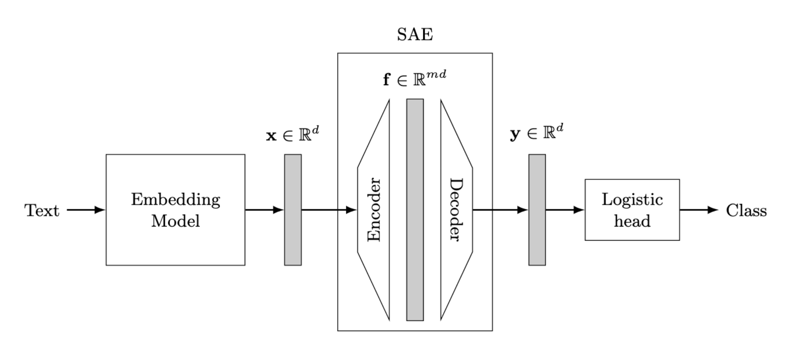
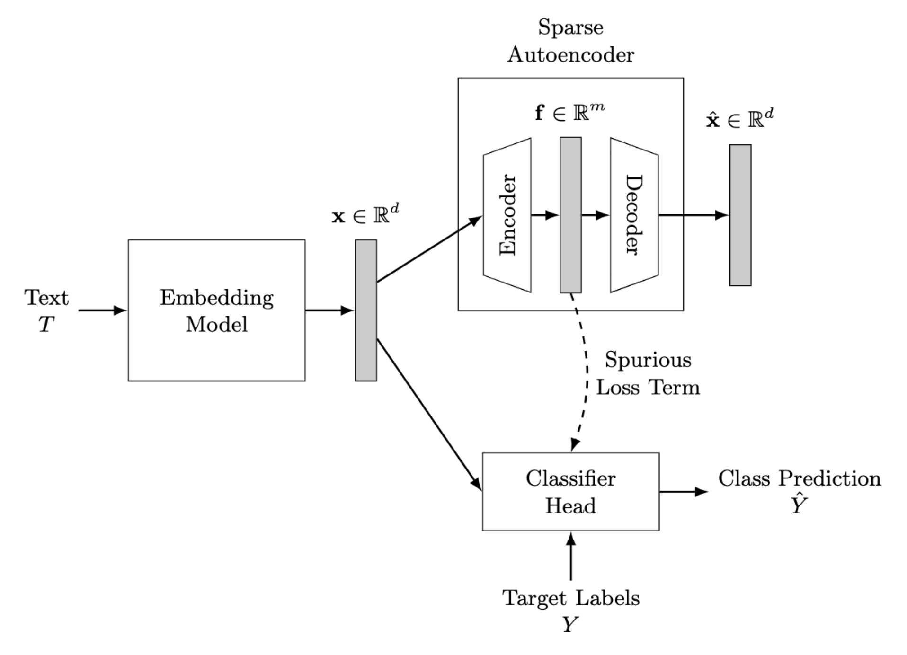

<!-- _class: title -->

# Project Proposal

## Nicolas and Satiya

### 2026-08-27

---

# Research Gap

- Previous project: SHIFT does not generalise beyond Bias in Biographies
- SHIFT was also complicated to implement and debug

---

# This project

**Goal: simplify and improve SHIFT** to generalise better across datasets

Main differences:
1) Use text embedding models: faster, cheaper, designed for embedding text
2) Use a single SAE: fewer features and no non-linear interactions
3) Train our own SAE: domain-specific and customisable

---

# Existing systems

- [HypotheSAE (2025):](https://arxiv.org/pdf/2502.04382) hypothesise relationships between text and target variables
- [LangSAE (2026):](https://aclanthology.org/2026.acl-long.1685.pdf) remove language identity information from representations

---

# Existing systems

---

# Setup

We are given a dataset of
1) Text documents $T$
2) Target labels $Y$ (binary or continuous)

The dataset might or might not be biased (i.e. have a spurious variable the classifier would latch onto)

---

# Diagnostic step

**Goal:** identify spurious variables by examining whether the feature explanations for the most target-relevant features are actually related to the target variable or not.

1) Embed the texts
2) Train an SAE on the text representations
3) Generate feature explanations
4) Order the features by relevance to the target variable
5) Inspect them (human or LLM) to identify which features in the SAE are spurious-related and which are target-related.

---

# Scrubbing step

**Goal:** train the classifier without a dependence on the spurious variable(s)

Several possible approaches:
1) Direct training dataset balancing
2) Counterfactually augment the training dataset
3) Annotate training dataset for spurious variable then INLP or Mean Projection
4) Ablate the features and train on the ablated representation (SHIFT-like)
5) Add a term to the classifier loss to distance it from the spurious feature directions

---

# Spurious Loss Term

---

# Practicalities

We want to target next ARR cycle (deadline **October 12 AoE**)
