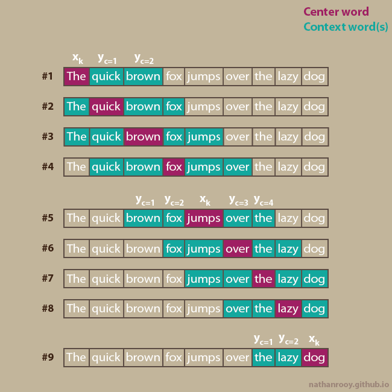
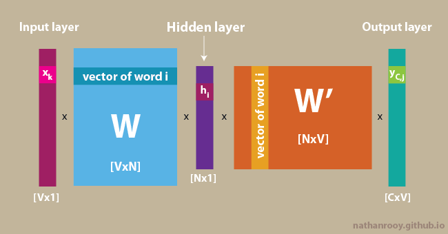

The central idea of Word2Vec is to train a simple neural network to learn the embeddings in an self supervised way. The vector embedding for each word is given by the hidden neurons in the hidden layer. There are two variants:
- ==CBOW==: given a context, train the network to predict the original word
- ==Skip-gram==: given a word, train the network to predict the context

 (image taken from [here](https://nathanrooy.github.io/posts/2018-03-22/word2vec-from-scratch-with-python-and-numpy/))

For skip-gram models, the network is trained on pairs of the word and its context within a certain window. For example the training set for the above example would be:
```
(the,   [quick,brown])
(quick, [the,brown,fox])
(brown, [the'quick,fox,jumps])
(fox,   [quick,brown,jumps,over])
(jumps, [brown,fox,over,the])
(over,  [fox,jumps,the,lazy])
(the,   [jumps,over,lazy,dog])
(lazy,  [over,the,dog])
(dog,   [the,lazy])
```

The network architecture is very simple, with a single hidden layer with an identity function as its activation function and a softmax output:

 (image taken from [here](https://nathanrooy.github.io/posts/2018-03-22/word2vec-from-scratch-with-python-and-numpy/))

The input to the network, $x_k$, is a single one-hot encoded word where $V$ is the size of the vocabulary. The hidden neurons $h$ will therefore always be rows of the weight matrix $W$ which connects the input layer to the hidden layer, where $N$ is the ==embedding dimension==. Softmax is used for the output layer. The output distribution is a distribution of the words that are the most likely to appear within a particular window of the input word. A full forward pass of the network is:
$$
y = Softmax(W'^T W^T x_k)
$$

Pros:
- Compressed embedding overcomes [[curse-of-dimensionality]]
- Closer meaning = closer physical vectors
- Self supervised means it's easy to get more data: just get more sentences!

Cons:
- Global information not preserved (fixed by [GloVe](./GloVe.md))
- Does not work well for morphologically-rich languages (fixed by [fasttext-word-embedding](./fasttext-word-embedding.md))
- Is not aware of broader context
## Links
- Original paper: [distributed-representations-of-words-and-phrases-and-their-compositionality](./distributed-representations-of-words-and-phrases-and-their-compositionality.md)
- [Tutorial with decent explanation](https://nathanrooy.github.io/posts/2018-03-22/word2vec-from-scratch-with-python-and-numpy/)
- [StatQuest video on the topic](https://www.youtube.com/watch?v=viZrOnJclY0)
- [Tutorial with some crappy but working code](https://www.geeksforgeeks.org/implement-your-own-word2vecskip-gram-model-in-python/)